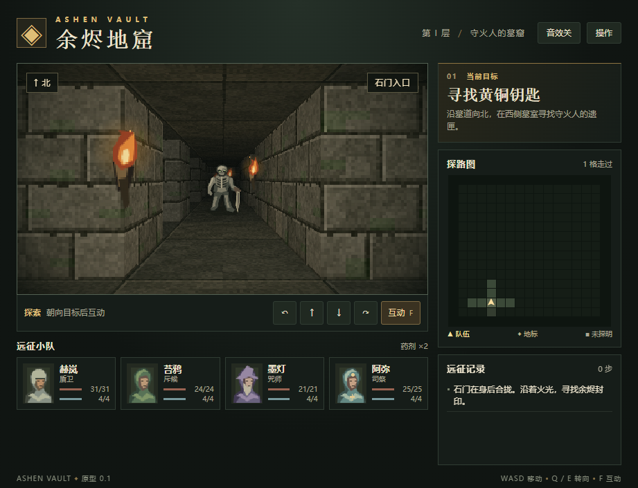

# 余烬地窟 · Ashen Vault

[](https://sjjsbxb.github.io/Underkeep/)
[](LICENSE)

一款纯前端、零依赖的第一人称地牢探索原型：在灰烬笼罩的墓窟中探索、标记、遭遇并与守卫者战斗。全部由原生 HTML / CSS / JavaScript 与 Canvas 2D 实现，无需构建步骤。

> A zero-dependency, first-person dungeon-crawler prototype written in vanilla HTML/CSS/JS with a hand-rolled Canvas 2D renderer.



## 试玩 / Play

- 在线试玩：https://sjjsbxb.github.io/Underkeep/
- 或直接双击 `index.html`（纯静态，无服务端依赖）

## 操作 / Controls

从灰鸦镇出发。点地图上的酒馆招募佣兵，点铁匠铺为指定英雄比较并购买装备。在右侧名册选择一名英雄，再从底栏进入出征整备，选择任务后独自下地牢。墓窟、矿井和修道院依次开放，首次通关分别奖励 60、90 和 120 金币，重访分别奖励 30、45 和 60 金币。

地牢每次行动后会自动保存。刷新后在营地选择「继续远征」，或者通过地牢内的「操作」菜单保存并返镇。完成、失败或放弃远征后会显示结算，可在小镇通过「上次远征」重看。

矿井排水后，可到东侧工具巷找回矿工名册。带着名册通关，铁匠会送给该英雄一把矿工短镐，并为其他英雄开放购买。短镐普攻无视最多 3 点护甲，淬火短刃则增加 2 点攻击。铁匠铺可免费切换已拥有的装备，换装从下一次出征起生效。

修道院的余烬壁灯打开西侧抄经廊，司钟人会频繁使出焚烬斩。寒银壁灯打开东侧回声廊，司钟人会先蓄力再使出寒钟碎响。击败他后敲响晨钟，在返镇结算中看到三关的结局。

| 操作 | 按键 |
| --- | --- |
| 前进 / 后退 | `W` / `S` 或 `↑` / `↓` |
| 左转 / 右转 | `Q` / `E` 或 `←` / `→` |
| 互动（搜索、开启、对话） | `F` |
| 战斗：攻击 / 战技 / 防御 / 药剂 | `1` / `2` / `3` / `4` |
| 帮助 / 音效开关 | 「操作」/「音效」按钮 |

触屏界面有独立的前进、后退、横移、转向和互动按钮。初次进地牢及第一场战斗时会出现上手提示。点「音效」可开启招募、购装、机关、药剂、蓄力和打断等动作提示音。

## 特性 / Features

- **第一人称伪 3D 渲染**：基于像素列投射的自制渲染器（`dungeon.js`），逐列计算墙体深度、纹理采样与距离衰减光照，无 WebGL、无第三方库。
- **网格地牢**：三张手工地图，包含墓窟石台、矿井排水和修道院双灯分路。
- **探索与解谜**：地标互动（宝箱、祭坛、封印门、传送门），未探索区域在探路图上保持迷雾。
- **营地**：招募斥候和咒师，分别为英雄购置武器、护甲、饰品和专属战技配件。
- **单人回合制战斗**：每次派一名英雄出征。预告显示敌人将如何行动，控制栏显示预计输出。盾卫的盾击能挡重击，斥候的穿刺能打断蓄力或重击，咒师的余火无视护甲并削弱它。防御回复专注，药剂恢复生命。
- **氛围表现**：小镇、设施室内和装备图标使用像素画，地牢有火把闪烁、纹理和动作提示音（WebAudio）。
- **战斗反馈**：像素斩痕、盾击火花、余火和浮动数值。首领重击有短促震屏，系统启用减少动态效果时会关闭震屏与粒子飞散。
- **无依赖 / 无构建**：双击入口即可运行。

## 文件结构 / Layout

```
.
├── index.html   # 页面骨架、HUD 与按钮
├── style.css    # 界面主题与响应式布局
├── camp.css     # 营地界面
├── camp-town-pixel.png # 灰鸦镇像素地图
├── camp-tavern-pixel.png # 断杯酒馆室内
├── camp-forge-pixel.png  # 余火铁匠铺室内
├── gear-pixel.svg # 七种装备的像素图标
├── camp.svg     # 灰鸦镇构图草稿
├── camp-interiors.svg # 酒馆与铁匠铺构图草稿
├── camp.js      # 招募、装备、英雄属性与营地存档
├── missions.js  # 三座地牢的地图、地标、敌人与任务报酬
├── expedition-save.js # 远征快照与恢复校验
├── combat-fx.js # 战斗像素特效、受击动作与浮动数值
├── dungeon.js   # 游戏循环、渲染器、战斗与交互逻辑
├── docs/
│   └── screenshot.png
└── README.md
```

## 本地开发 / Development

无需安装任何依赖：

```bash
# 任选其一
python -m http.server 8000
npx serve .
```

然后打开 `http://localhost:8000`。

修改 `dungeon.js` 后刷新页面即可生效。

## 开发计划 / Roadmap

### 已完成 · 0.8

- 两座手工地牢，三名英雄各自单人出征，具备职业战技和专属配件。
- 灰鸦镇招募与整备、地牢自动存档与续玩、返镇结算。
- 矿井名册支线、短镐穿甲、营地换装与属性对比。
- 像素画、触屏操作、新手提示、动作音效与战斗特效。

### 已完成 · 0.9「失声修道院」

- [x] 通关矿井后解锁修道院，旧存档按通关记录开放任务。
- [x] 加入两条手工路线。点亮不同壁灯会改变可走的通路，也会改变首领的招式预告。
- [x] 补齐第三关通关后的返镇结局。
- [x] 验收两条路线均可通关，三名英雄都能各自完成三关。刷新后，已点亮的壁灯和首领战状态可恢复。

### 1.0 · 完整试玩版

- [ ] 邀请首次接触游戏的玩家从新存档试玩，记录卡关、误读和操作困难。
- [ ] 根据反馈调整支线指引、药剂供给和首领预告，主线目标约 30–45 分钟，顺着主线即可走到结局。
- [ ] 验证桌面键盘、手机触屏、旧存档升级和奖励结算。
- [ ] 整理离线试玩包，解压后双击 `index.html` 即可游玩。

1.0 之后再评估随机地牢与配乐扩展。

## 许可 / License

[MIT](LICENSE)
